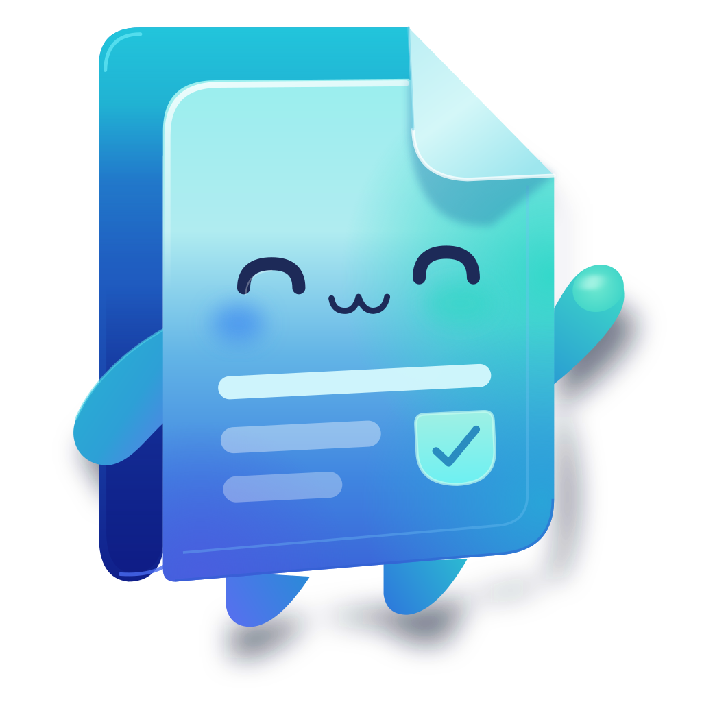
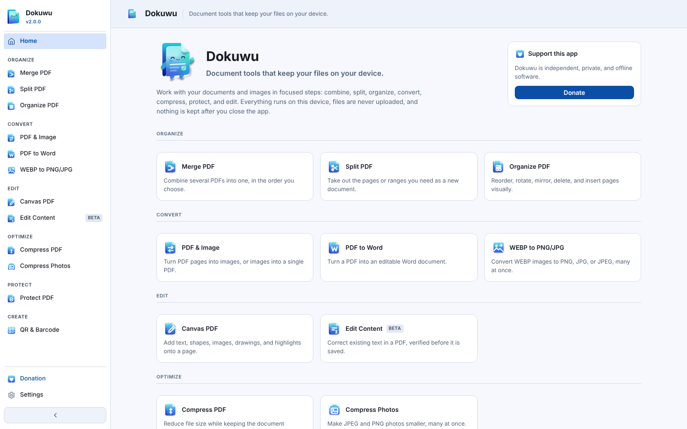
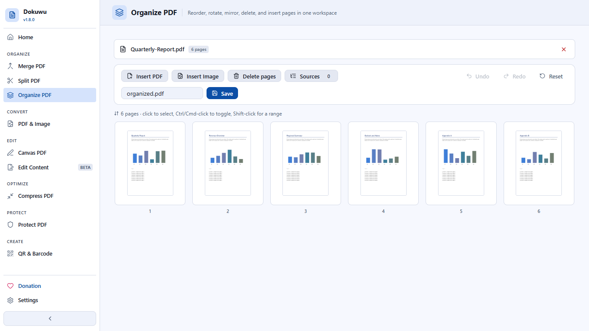
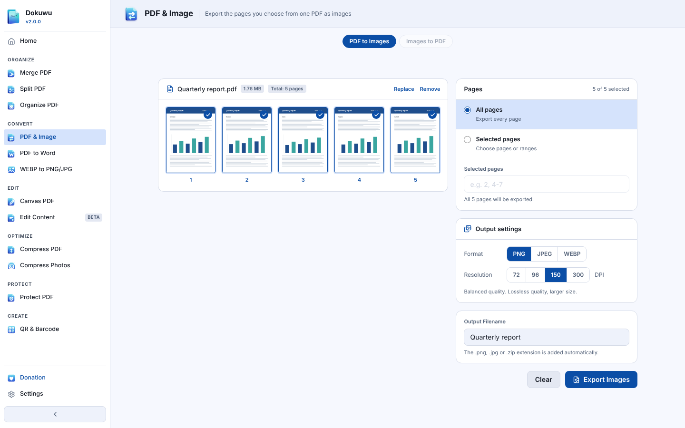
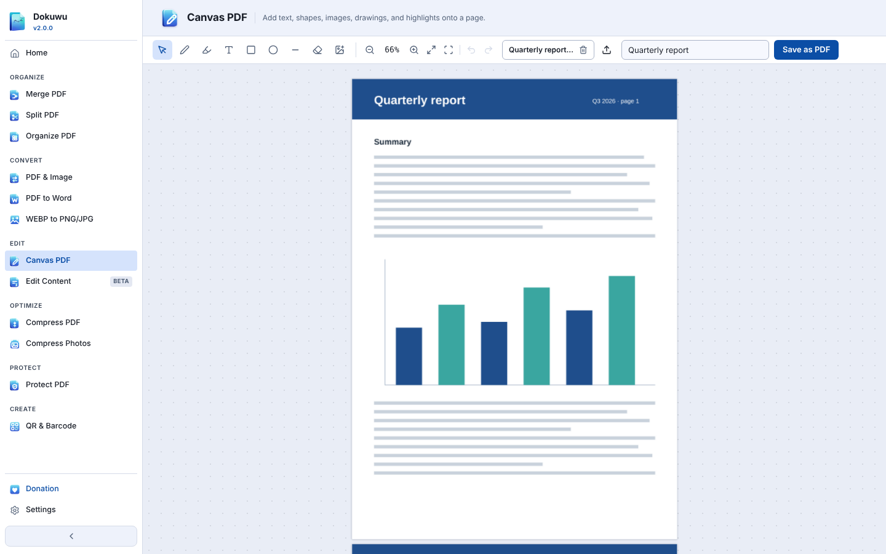
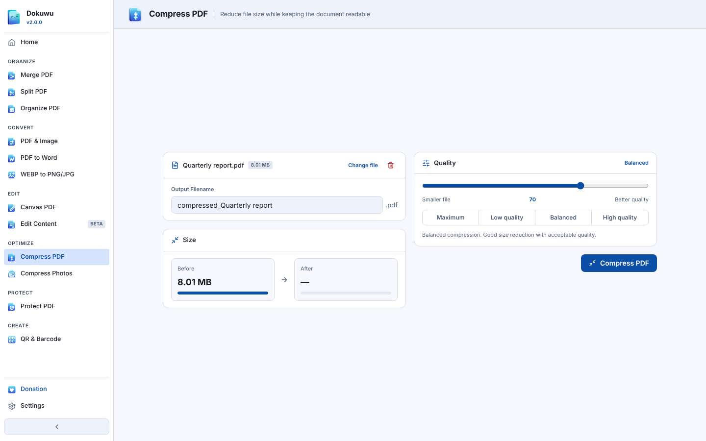
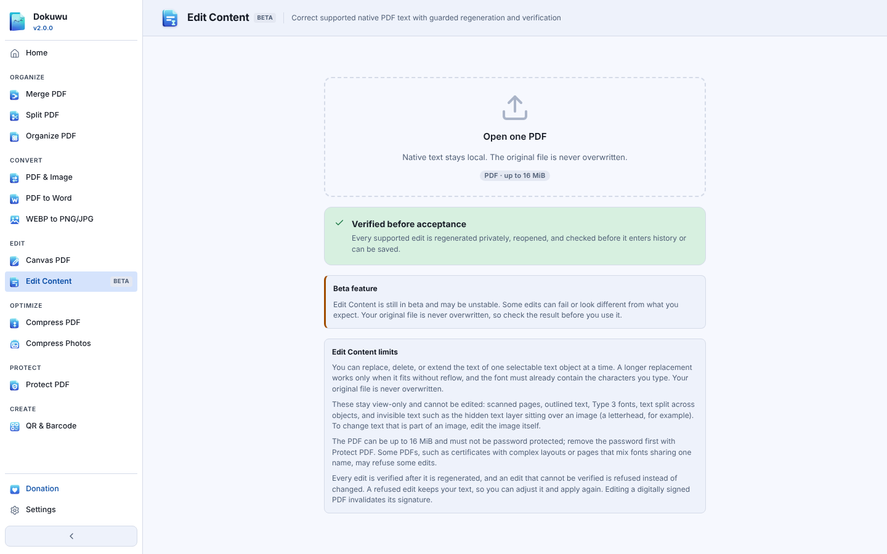
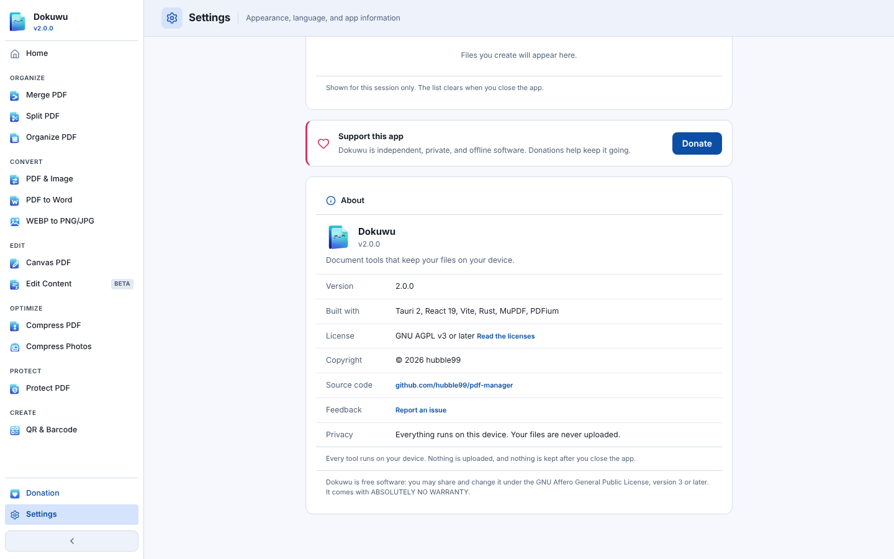
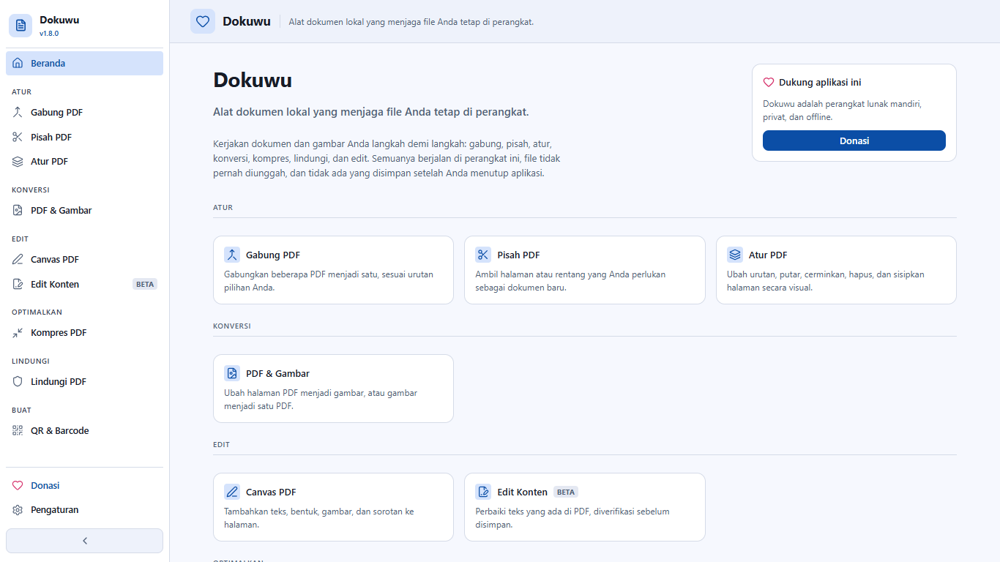
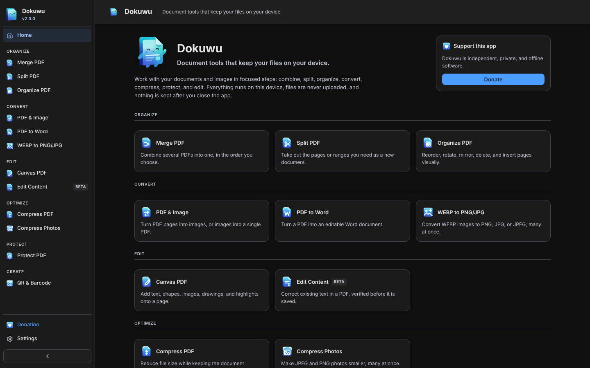

<p align="center">
  
</p>

<h1 align="center">Dokuwu</h1>

<p align="center">
  <strong>Twelve PDF and image tools in one app. Offline. Free. Yours.</strong><br>
  Merge, split, organize, compress, convert, edit and protect documents without sending a single byte anywhere.
</p>

<p align="center">
  <a href="https://apps.microsoft.com/detail/9NC9W2L2DG15"></a>
  <a href="https://github.com/hubble99/pdf-manager/releases/latest"></a>
</p>

<p align="center">
  
  
  
  
  
</p>

<p align="center">
  
</p>

> Dokuwu used to be called PDF Manager. The repository keeps the old name so existing links still work.

## Why Dokuwu?

- **It never phones home.** Your files are processed on your PC, never uploaded, and nothing is kept after you close the app. There is no account, no ads and no tracking, so it is fine for contracts, payslips and anything confidential.
- **It never overwrites your files.** Results land in your Downloads folder under a free name (`report (1).pdf`). The original is not touched.
- **It is light.** One small native program, no background helper, no local server. It opens at once and stays out of your RAM.
- **It tells you when it can't.** Edit Content checks every change by reopening the result, and says no rather than risk damaging your document.
- **It is free software.** Read it, change it, share it. See [License](#license).

## What it does

| | Tool | What you get |
|---|---|---|
| 📎 | **Merge PDF** | Combine several PDFs (or a whole folder) into one, in the order you choose |
| ✂️ | **Split PDF** | Take out pages or ranges as a new document; Shift-click selects a range |
| 🗂️ | **Organize PDF** | Reorder, rotate, mirror, delete and insert pages (even whole PDFs or images) visually |
| 🖼️ | **PDF & Image** | PDF pages to PNG, JPEG or WEBP (or a ZIP of them), and images to one PDF |
| 📝 | **PDF to Word** | Turn a PDF into an editable `.docx` |
| 🔄 | **WEBP to PNG/JPG** | Convert WEBP images in bulk |
| ✏️ | **Canvas PDF** | Add text, pictures, shapes, lines, drawings and highlights onto pages |
| 🔧 | **Edit Content** (beta) | Correct the existing text of a PDF, verified before it is saved |
| 🗜️ | **Compress PDF** | Shrink a PDF; a 158-page, 62 MB report takes about five seconds |
| 📷 | **Compress Photos** | Make JPEG and PNG photos smaller, many at once |
| 🔒 | **Protect PDF** | Add or remove a password and set permissions |
| 🔲 | **QR & Barcode** | QR codes and Code128, EAN-13, EAN-8 and Code39 barcodes as images |

Dokuwu speaks **English** and **Bahasa Indonesia** (Settings > Language) and comes in four themes: Light, Dark, Dusty Rose and Steel Blue.

## Screenshots

<p align="center">
  
  
  <br>
  
  
  <br>
  
  
  <br>
  
  
</p>

## Install

**Microsoft Store (easiest):** [Get Dokuwu from the Microsoft Store](https://apps.microsoft.com/detail/9NC9W2L2DG15). Updates come with Windows.

**Installer:** download the setup from [Releases](https://github.com/hubble99/pdf-manager/releases/latest), run it (it installs for the current user, no admin rights needed) and start **Dokuwu** from the Start menu.

Requirements: Windows 10 (1809) or 11, 64-bit, 4 GB RAM, 500 MB of disk space. The Microsoft Edge WebView2 Runtime, which Windows 11 already has, is needed to show the interface.

> **SmartScreen:** the installer is not code-signed, because a certificate costs money and this is a free project. If Windows says "Windows protected your PC", click **More info** and then **Run anyway**. The Store version is signed by Microsoft. You can also read every line of the source below.

## Privacy

Everything runs on your computer. Dokuwu has no network code: it does not upload, check for updates or send statistics. Read the [Privacy Policy](https://hubble99.github.io/pdf-manager/privacy.html) (English and Bahasa Indonesia).

<details>
<summary><strong>Edit Content: what it can and cannot safely do</strong></summary>

Edit Content edits the **existing native text** of a supported PDF. A change is
published only after it has been regenerated privately, reopened, and verified;
the original file is never overwritten. Edit Content is intentionally
conservative — a rejection means the edit could not be proven safe, not that the
application failed.

**Supported**

- Editing existing native/selectable PDF text.
- Replacing an existing text range inside one supported text object: typo
  corrections, word replacement, and shorter replacements.
- Deleting a supported existing range inside a text object.
- Genuine longer replacements that replace an existing range and need no reflow;
  the object's own bounds may expand while surrounding content keeps its
  position.
- Saving only after integrity and safety verification succeeds.
- Undo/redo across accepted checkpoints.
- Safe fail-closed rejection when preservation cannot be proven.

**Current V1 limitations**

- It is not a general-purpose PDF word processor.
- It edits native/selectable text only. Scanned or image-only text and outlined
  text stay view-only; there is no OCR.
- The supported model is replacement of a **non-empty existing range** inside one
  text object. Pure insertion-style edits are not supported by the current draft
  model — for example `Gedung → Gedungs` is interpreted as an insertion and is
  rejected, with a message asking you to replace or remove existing text instead.
- Automatic text reflow, paragraph layout, wrapping, new lines, and object
  movement are outside V1.
- Replacement characters must be safely representable by the exact embedded
  font and resources the document already uses. A missing glyph rejects the edit,
  and V1 never substitutes another font to make unsupported characters available.
- Some PDFs with unsupported or ambiguous font/resource structures are
  intentionally rejected (for example Type 3 text, words split across text
  objects, or colliding font resources).
- Some formatting or layout changes are rejected when preservation cannot be
  proven.
- Rejections leave the document, the accepted revision, and the publication state
  unchanged and produce no download. After certain guarded rejections the
  selection is cleared and you must select the text again before retrying.
</details>

## Under the hood

Dokuwu is a [Tauri](https://tauri.app/) shell around a React interface, and every tool runs in a Rust core. The long version, with a diagram, is in [docs/ARCHITECTURE.md](docs/ARCHITECTURE.md).

| Layer | Technology |
|---|---|
| Desktop shell | Tauri 2.11 |
| Interface | React 19, TypeScript 6, Vite 8, Tailwind CSS 4, React Router 7, lucide-react |
| PDF engine | [MuPDF](https://mupdf.com/) through the `mupdf` crate 0.8 |
| Edit Content engine | [PDFium](https://pdfium.googlesource.com/pdfium/) (pinned build, see `native/edit-content-engine/pdfium-artifacts.json`) in its own process |
| Images | `image`, `webp`, `jpeg-encoder`, `png` |
| QR and barcodes | `qrcode` and Rust encoders in `dokuwu-core` |
| Canvas | fabric.js |
| Rust | 1.88 or newer |

## Build from source

You need [Node.js](https://nodejs.org) 20.19+, [Rust](https://rustup.rs) 1.88+, and on Windows the Visual Studio Build Tools (C++ workload) and LLVM (`winget install LLVM.LLVM`), because MuPDF is compiled from C.

```powershell
git clone https://github.com/hubble99/pdf-manager.git
cd pdf-manager

# Environment for the MuPDF build (sets LIBCLANG_PATH and the MSVC toolset)
. native\dokuwu-core\windows\build-env.ps1

cd frontend
npm ci
npm run prepare:edit-content:desktop   # builds the Edit Content worker and fetches the pinned PDFium

npm run tauri:dev                      # run the app
npm run tauri:build                    # make the installers
```

The installers end up in `frontend/src-tauri/target/release/bundle/`. Every feature runs in the Rust core, so it only works inside the Dokuwu window: a browser tab shows the interface but has no file access. To make the Microsoft Store package, see [packaging/msix](packaging/msix/README.md).

## Tests

```powershell
cargo test --locked --manifest-path native/dokuwu-core/Cargo.toml
cd frontend
npm test
npx tsc -b
npm run lint
```

More in [docs/ARCHITECTURE.md](docs/ARCHITECTURE.md#tests).

## Good to know

Dokuwu is a finished, small project made by one person, and it is **not going to be maintained for long**. Bug reports are welcome and I read them, but do not count on quick answers. The licence lets you fork it and keep it going, so please do.

If it saved you an evening, there is a support page inside the app (Donate).

## License

Dokuwu is free software under the **[GNU Affero General Public License, version 3 or later](LICENSE)**. In plain words: you can use it for anything, read and change the source, and share it, as long as whoever gets your version gets the same freedoms and the source code. It comes with **no warranty**.

It has to be AGPL because it is built on MuPDF, which is AGPL. The licenses of everything else it is built from (about 600 Rust crates and npm packages, PDFium and the bundled fonts) are listed in [THIRD-PARTY-NOTICES.txt](THIRD-PARTY-NOTICES.txt), and in the app under Settings > About > Read the licenses. The source of every released version is the git tag with its name (for example `v2.0.0`).

Copyright (C) 2026 hubble99. Your own PDFs and images stay yours: the license covers the program, not the documents you process.

## Thanks

[MuPDF](https://mupdf.com/) and [PDFium](https://pdfium.googlesource.com/pdfium/) do the heavy lifting; [Tauri](https://tauri.app/), [React](https://react.dev/) and [fabric.js](https://fabricjs.com/) make it a desktop app; and the Rust and npm communities wrote the rest. Thank you.
